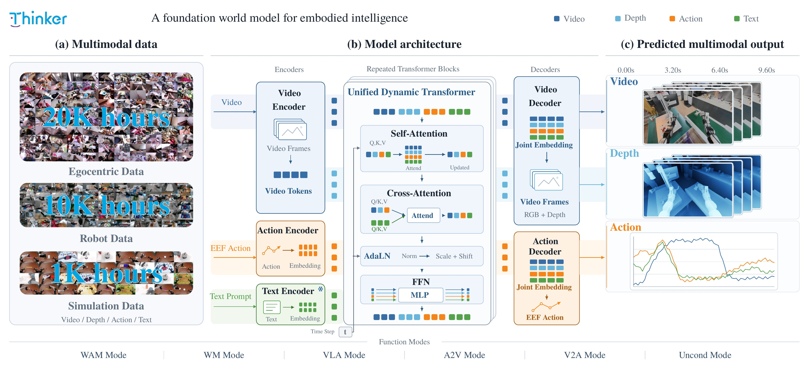

<div align="center">
     


# Thinker-WM: A Unified World Model with Shared Multimodal Backbone for Embodied Intelligence

**Thinker Team, Ubtech**

<!-- Replace the <your-org> repo/project links and the arXiv id below with the
     real addresses when publishing. -->

<a href="https://thinkercosmos.ubtrobot.com/thinker-wm/"></a>
<a href="https://huggingface.co/UBTECH-Robotics/Thinker-WM/tree/main"></a>
<a href="https://arxiv.org/abs/2609.xxxxx"></a>
<a href="https://github.com/UBTECH-Robot/Thinker-WM/blob/main/LICENSE"></a>
</div>


Thinker-WM is a unified multimodal world model that jointly models and generates
RGB, depth, and action through a shared intermediate Transformer backbone with
modality-specific input and output experts. This repository is the official
inference release: load a checkpoint and run six inference modes on a single GPU.

<p align="center">
  
</p>

## Introduction

World models have emerged as a promising paradigm for embodied AI, yet existing
systems remain fragmented: most focus on RGB and action, while simulation and
robot control are typically addressed by separate models or frameworks.

Thinker-WM unifies multimodal representation learning while supporting both
world/data generation and direct action modeling for robot control within a
single framework. A shared backbone processes interleaved RGB, depth, action,
and language tokens with directed cross-modal attention; modality-specific
experts handle inputs and outputs. A probing framework over the shared
representations reveals rich, fine-grained action information, providing a
strong foundation for action modeling and generation.

Thinker-WM is pretrained on 20K hours of egocentric data and 10K hours of robot
data (≈4K hours with aligned depth supervision) and supports multiple generation
modes — image-to-video-action, text-to-video-action, and action-to-video —
covering applications from simulation and planning to real-robot control. It
ranks **1st** on three public benchmarks: **EWMBench**, **World Olympiad**, and
**World Arena**.

## Evaluation Results

Thinker-WM is evaluated on embodied world-model benchmarks covering real-robot and simulated environments, together with controlled evaluations of action conditioning and geometric prediction.

### Main Benchmarks

| Benchmark         | Setting                     |     Metric | Thinker-WM |    Rank |
| ----------------- | --------------------------- | ---------: | ---------: | ------: |
| **EWMBench**      | Embodied world model        |  Overall ↑ |   **4.66** | **1st** |
| **WorldOlympiad** | Robotics sub-leaderboard    |  Overall ↑ |  **0.739** | **1st** |
| **WorldArena**    | Track-1, 12-metric protocol | EWMScore ↑ |  **71.73** | **1st** |

### Detailed Results

#### EWMBench

| Model           |   SceneC ↑ |      HSD ↑ |      Dyn ↑ |     nDTW ↑ | Diversity ↑ |     BLEU ↑ |     CLIP ↑ |   Logics ↑ | Overall ↑ |
| --------------- | ---------: | ---------: | ---------: | ---------: | ----------: | ---------: | ---------: | ---------: | --------: |
| Veo3            |     0.8415 |     0.2130 |     0.1932 |     0.1613 |      0.0221 |     0.2139 |     0.8965 |     0.9474 |      3.49 |
| Wan2.6          |     0.6712 |     0.2034 |     0.0900 |     0.1715 |      0.0502 |     0.1616 |     0.8743 |     1.0000 |      3.22 |
| Kling26         |     0.8211 |     0.3272 |     0.1822 |     0.3423 |      0.0173 |     0.2591 |     0.9014 |     1.0000 |      3.85 |
| LTX-2           |     0.7850 |     0.2076 |     0.1283 |     0.2443 |      0.0120 |     0.1425 |     0.8869 |     0.5000 |      3.01 |
| Sora2           |     0.8526 |     0.2807 |     0.3494 |     0.2754 |      0.0314 |     0.2466 |     0.9100 |     0.9474 |      3.89 |
| Cosmos          |     0.7963 |     0.2500 |     0.2052 |     0.2533 |      0.0803 |     0.1230 |     0.8458 |     0.7333 |      3.29 |
| GigaWorld       |     0.8707 |     0.3050 |     0.0849 |     0.2783 |      0.0278 |     0.2048 |     0.8873 |     0.9000 |      3.56 |
| LVP             |     0.8795 |     0.4248 |     0.0433 |     0.6226 |      0.0093 |     0.2179 |     0.8995 |     0.9524 |      4.05 |
| Vidar           |     0.7341 |     0.1877 |     0.1520 |     0.1769 |      0.0653 |     0.1607 |     0.8821 |     0.9411 |      3.30 |
| WoW             |     0.8866 |     0.2494 |     0.0529 |     0.2566 |      0.0266 |     0.1932 |     0.9001 |     0.9524 |      3.52 |
| Qwen-RobotWorld |     0.9142 |     0.5660 |     0.3429 |     0.6708 |      0.0114 |     0.2079 |     0.8834 |     1.0000 |      4.60 |
| **Thinker-WM**  | **0.8877** | **0.5638** | **0.3630** | **0.7102** |  **0.0117** | **0.2691** | **0.9020** | **0.9524** |  **4.66** |

#### [WorldOlympiad](https://alibaba-damo-academy.github.io/WorldOlympiad/#leaderboard)

**Robotics leaderboard**

| Model              | Physical ↑ | 3D Cons. ↑ |    CLIP ↑ | Interact. ↑ |     All ↑ |
| ------------------ | ---------: | ---------: | --------: | ----------: | --------: |
| Uranus             |      0.925 |      0.511 |     0.304 |       0.730 |     0.722 |
| Cosmos-Predict-2.5 |      0.937 |      0.479 |     0.321 |       0.721 |     0.712 |
| LingBot-World      |      0.949 |      0.393 |     0.314 |       0.710 |     0.684 |
| Rolling Forcing    |      0.870 |      0.389 |     0.329 |       0.566 |     0.608 |
| LongLive           |      0.857 |      0.472 |     0.327 |       0.470 |     0.600 |
| Yume-1.5           |      0.851 |      0.288 |     0.312 |       0.624 |     0.588 |
| WoW                |      0.787 |      0.272 |     0.288 |       0.447 |     0.502 |
| **Thinker-WM**     |  **0.923** |  **0.531** | **0.305** |   **0.764** | **0.739** |

#### WorldArena

**Track-1, 12-metric evaluation protocol**

| Model                     | 12-Metric EWMScore ↑ |
| ------------------------- | -------------------: |
| DexWorldEngine            |                71.01 |
| BWM-Fast                  |                70.97 |
| UNIS                      |                70.79 |
| MotuBrain                 |                70.18 |
| Wan2.6                    |                67.43 |
| Cosmos-Predict2.5(Action) |                64.40 |
| **Thinker-WM**            |            **71.73** |

For the WorldArena Track-1 evaluation, the reported EWMScore is the unweighted mean of 12 metrics covering visual quality, content consistency, physics adherence, 3D accuracy, and controllability. Dynamic Degree, Flow Score, and Motion Smoothness are excluded because of their sensitivity to frame rate and temporal sampling density.

### Additional Evaluations

| Evaluation                                | Metric         |       Result |
| ----------------------------------------- | -------------- | -----------: |
| Action-conditioned generation on EWMBench | Overall ↑      |     **5.03** |
| Action-conditioned generation on EWMBench | HSD ↑          |   **0.7369** |
| Action-conditioned generation on EWMBench | nDTW ↑         |   **0.8736** |
| Generated depth on AgiBot                 | AbsRel ↓       |   **0.1360** |
| Generated depth on AgiBot                 | RMSE ↓         | **0.1790 m** |
| Closed-loop control on RoboTwin           | Success Rate ↑ |    **75.0%** |
| Motion Probe on held-out AgiBot windows   | Action MSE ↓   |    **0.116** |


### RoboTwin: 50-Task Evaluation

We evaluate Thinker-WM on 50 RoboTwin tasks under Clean and Randomized settings. Success rate (SR) is reported as a percentage; higher is better.

| Model | Clean SR (%) ↑ | Randomized SR (%) ↑ |
| :--- | ---: | ---: |
| **Thinker-WM** | **92.6** | **91.4** |

*Mean SR is the unweighted average across the 50 tasks. Randomization reduces mean SR by 1.2 percentage points.*

<details>
<summary><b>Per-task results — all 50 tasks</b></summary>

Tasks are ordered by Clean SR (ascending), with ties following the supplied task order.

| Task | Clean SR (%) ↑ | Randomized SR (%) ↑ |
| :--- | ---: | ---: |
| `hanging_mug` | 63 | 57 |
| `open_microwave` | 65 | 60 |
| `move_stapler_pad` | 72 | 67 |
| `put_object_cabinet` | 76 | 72 |
| `turn_switch` | 79 | 75 |
| `handover_block` | 80 | 77 |
| `place_can_basket` | 80 | 77 |
| `beat_block_hammer` | 85 | 82 |
| `place_dual_shoes` | 87 | 85 |
| `blocks_ranking_size` | 89 | 87 |
| `scan_object` | 89 | 88 |
| `move_playingcard_away` | 90 | 88 |
| `press_stapler` | 91 | 89 |
| `place_bread_basket` | 92 | 91 |
| `place_object_basket` | 92 | 91 |
| `stack_bowls_three` | 92 | 91 |
| `handover_mic` | 93 | 92 |
| `pick_diverse_bottles` | 93 | 92 |
| `place_mouse_pad` | 93 | 92 |
| `blocks_ranking_rgb` | 94 | 93 |
| `place_phone_stand` | 94 | 93 |
| `dump_bin_bigbin` | 94 | 93 |
| `put_bottles_dustbin` | 94 | 93 |
| `stack_blocks_three` | 94 | 93 |
| `place_a2b_right` | 95 | 94 |
| `place_bread_skillet` | 95 | 94 |
| `rotate_qrcode` | 96 | 95 |
| `move_can_pot` | 97 | 96 |
| `place_object_scale` | 97 | 96 |
| `place_fan` | 97 | 97 |
| `stack_bowls_two` | 97 | 97 |
| `move_pillbottle_pad` | 98 | 98 |
| `open_laptop` | 98 | 98 |
| `place_a2b_left` | 98 | 98 |
| `place_object_stand` | 98 | 97 |
| `place_burger_fries` | 99 | 98 |
| `adjust_bottle` | 99 | 99 |
| `place_container_plate` | 99 | 99 |
| `place_shoe` | 99 | 99 |
| `shake_bottle` | 99 | 99 |
| `stack_blocks_two` | 99 | 99 |
| `stamp_seal` | 99 | 99 |
| `click_alarmclock` | 100 | 100 |
| `click_bell` | 100 | 100 |
| `grab_roller` | 100 | 100 |
| `lift_pot` | 100 | 100 |
| `pick_dual_bottles` | 100 | 100 |
| `place_cans_plasticbox` | 100 | 100 |
| `place_empty_cup` | 100 | 100 |
| `shake_bottle_horizontally` | 100 | 100 |
| **Average (50 tasks)** | **92.6** | **91.4** |

</details>

## Installation

- Python 3.10+
- NVIDIA CUDA GPU; `flash-attn` is a hard dependency (see `requirements.txt`;
  pre-built wheels available if you cannot compile)
- `pip install -r requirements.txt`

## Model Weights

Weights live under `model_weights/` in the repo root (gitignored):

| File | Description | Size |
|---|---|---|
| `checkpoint/pytorch_model_0.bin` | ThinkerWM main weights (Wan backbone / VLM / action branch included) | ~24 GB |
| `wan/config.json` | Wan architecture config (structure only) | small |
| `wan/Wan2.2_VAE.pth` | Wan2.2 video VAE (separate file — it is not contained in the main checkpoint, but ships with `model_weights/`) | GB-scale |
| `qwen3_vl/` | Qwen3-VL directory, **config/tokenizer/processor files only** (VLM weights are inside the checkpoint; no safetensors needed) | ~12 MB |
| `action_stats.json` | Per-robot action normalization statistics | ~10 KB |

### HuggingFace Download

> Replace `<your-org>/thinkerwm` with the real repo id on release:
> https://huggingface.co/<your-org>/thinkerwm

```bash
# placeholder — replace with the actual repo id on release
# huggingface-cli download <your-org>/thinkerwm --local-dir model_weights
```

## Quickstart

One-command example (runs `wm` with depth / `wam` / `vla` on the bundled sample,
into `outputs/example/`; prints a download guide if weights are missing):

```bash
bash examples/run_example.sh
```

CLI (`--config` / `--checkpoint` default to the layout above and can be omitted).
The primary example is **WAM mode** — joint video + action generation from a
prompt, a first frame, and a robot state:

```bash
python main.py infer --mode wam \
    --prompt "$(cat examples/ewmbench_sample/prompt.txt)" \
    --first-frame examples/ewmbench_sample/first_frame.png \
    --state examples/ewmbench_sample/state.npy \
    --robot-name agibot-a2-d \
    --output outputs/wam_demo
# -> outputs/wam_demo/video.mp4 + actions.npy

# add depth output (requires enable_depth: true):
python main.py infer --mode wam ... --depth-first first_depth.npy --output outputs/wam_depth
# -> video.mp4 + actions.npy + depth.mp4 + depth_m.npy (metric depth)

# wm: video only;  vla: actions only
python main.py infer --mode wm  --prompt "..." --first-frame first_frame.png --output outputs/wm_demo
python main.py infer --mode vla --prompt "..." --first-frame first_frame.png --robot-name agibot-a2-d --output outputs/vla_demo
```

Python API:

```python
from main import ThinkerWMPipeline

pipe = ThinkerWMPipeline("configs/inference_example.yaml",
                         "model_weights/checkpoint")
out = pipe.infer(
    mode="wam",
    prompt="Pick up the red block.",
    first_frame="frame0.png",          # path / PIL.Image / [3,H,W] tensor
    state="0.01,0.02,...",             # optional; see Six Modes
    robot_name="agibot_beta",          # aliases from the config are supported
    depth_first="depth0.npy",          # optional; provided -> also produces depth
)
out["video"]    # [3, T, H, W] float [0,1]
out["actions"]  # [num_video_frames*ratio, action_dim] float
out["depth"]    # [3, T, H, W] float [0,1] codec domain (optional)
pipe.save_outputs(out, "outputs/demo")
```

## Six Modes

| mode | inputs | outputs |
|---|---|---|
| `wam` | prompt + first_frame + robot (state optional) | video + actions (+depth) |
| `wm` | prompt + first_frame (robot/depth_first optional) | video (+depth) |
| `vla` | prompt + first_frame + robot (state optional) | actions |
| `a2v` | first_frame + actions + robot (state optional) | video |
| `v2a` | video (exactly 1+num_video_frames frames) + robot (state optional) | actions |
| `uncond` | first_frame + robot (state optional) | video + actions |

**state is optional in every mode.** The model predicts relative end-effector
actions: without `state`, `actions` contains relative quantities (position
delta + relative 6D rotation); when `state` is given, actions are restored to
absolute quantities using it as the anchor. `robot_name` is required for all
action-input/output modes (normalization and dim-map lookup).

`a2v` / `v2a` / `uncond` take no prompt (an empty-text constant condition is
used internally); `wam` / `wm` / `vla` use the prompt directly as the VLM text
condition.

## Inference Hyperparameters

Overridable via CLI flags (or `pipe.infer(...)` kwargs):

| Flag | Default | Description |
|---|---|---|
| `--num-inference-steps` | 50 | Video denoising steps |
| `--guidance-scale` | 5.0 | Video CFG scale (forced to 1.0 in `uncond` mode) |
| `--action-guidance-scale` | 1.0 | Action CFG scale (off by default) |
| `--action-num-inference-steps` | 10 | Action denoising steps |
| `--action-smooth-alpha` | 0.0 | Action temporal EMA smoothing |
| `--depth-smooth-alpha` | 0.0 | Depth temporal EMA smoothing |

## Input / Output

- **first_frame**: RGB image, resized to `video_height x video_width`.
- **state / actions**: raw physical quantities in the robot reader convention;
  normalization and unified-space scatter happen at the model boundary.
- **depth_first**: codec-domain [0,1] grayscale; `.npy` float (already encoded),
  `.npy` uint16 (millimetres, encoded with `depth_z_near/z_far/mode`), or a
  grayscale image.
- **video (`v2a`)**: video file or `[T,3,H,W]` tensor with exactly
  `1+num_video_frames` frames (first frame = conditioning frame).
- Outputs: `video.mp4` (5 fps), `actions.npy` (`[action_chunk_size, action_dim]`),
  `depth.mp4` / `depth_m.npy`.


## Citation

If you find Thinker-WM useful, please cite:

```bibtex
@article{thinkerwm2026,
  title={Thinker-WM: A Unified World Model with Shared Multimodal Representations for Embodied Intelligence},
  author={Thinker Team, Ubtech},
  year={2026}
}
```

## Contributors

**Core Authors**: Chen Liao, Jiyuan Wang, [Xiongwei Zhao](https://grandzxw.github.io/)

**Authors**: Peng Gao, Yiming Ma, Daqin Luo, Xiangming Xu

**Project Lead**: Baiyu Pan

**Advisors**: Jichao Jiao, Hailin Shi
